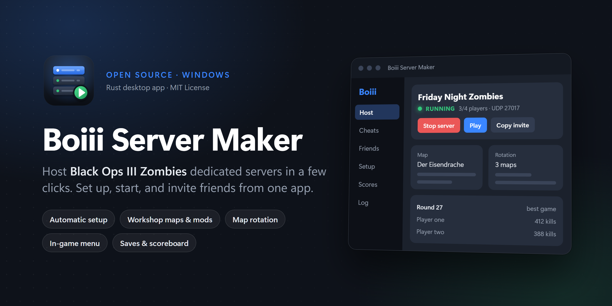

<p align="center">
  
</p>

# Boiii Server Maker

**Set up, host, and manage Black Ops III Zombies dedicated servers on Windows.**

A Rust desktop app for the BOIII client: discover your Steam installation, choose a map, and start a server from one interface. Includes a classic fallback interface and a command-line tool for scripting.

**Version:** 0.51.0 · **Platform:** Windows 10/11 (64-bit) · **License:** [MIT](LICENSE)

[Quick start](#quick-start) · [Build from source](#build-from-source) · [User guide](installer/README.txt) · [Contributing](CONTRIBUTING.md)

> No game files or BOIII client binaries are included in this repository or installer. Setup uses your own Black Ops III installation and the Steam dedicated server tool. This independent project is not affiliated with Activision, Treyarch, Valve, or the BOIII project.

## Features

| Feature | What you can do |
| --- | --- |
| Automatic setup | Discover Steam libraries, prepare server files, and generate configuration. Install missing server files through Steam or SteamCMD. |
| Server controls | Start, stop, check status, repair files, and launch the game on the same PC. |
| Maps and mods | Select installed official Zombies maps and subscribed Workshop content. Workshop folders are linked instead of copied. |
| Map rotation | Configure multiple maps and save map, mod, and gameplay presets. |
| In-game menu | Manage weapons, perks, points, power-ups, movement, zombies, and player actions. Optionally restrict access by player name. |
| Save and continue | Use three manual save slots or round autosaves; restore supported player and world state after restarting. |
| Scoreboard | Review finished games by round and player statistics. |
| Playing with friends | Copy connection commands, add Favorites, configure a tunnel address, and inspect network connectivity. |

The app does not change firewall or router settings. Network checks explain what needs to be allowed.

## Requirements

- Windows 10 or 11, 64-bit.
- A Steam installation of **Call of Duty: Black Ops III** with Zombies content.
- **Call of Duty: Black Ops III – Unranked Dedicated Server** files; setup can help install these if missing.
- An internet connection for initial downloads. Workshop maps and mods must be installed through Steam.

## Quick start

If a release is available, download `BoiiiServerMakerSetup.exe` from this repository's **Releases** section and run it. The installer runs per user without administrator rights. It is not code-signed, so Windows SmartScreen may display a warning. If no release is published yet, [build from source](#build-from-source).

1. Open **Boiii Server Maker**.
2. On **Host**, choose a map and an optional mod.
3. Select **Start server**. The first run also prepares the server files; wait for **Running**.
4. Select **Play** to launch the game on this PC.
5. At the game's main menu, open the console with `~`, paste the copied connection command with **Ctrl+V**, and press **Enter**.
6. Use **Copy invite** to share the appropriate connection command with friends.

See the [complete user guide](installer/README.txt) for setup, controls, and troubleshooting.

### Command line

Run these commands from the installed application folder in PowerShell:

```powershell
.\bsm.exe status
.\bsm.exe maps
.\bsm.exe setup --map zm_zod --port 27017
.\bsm.exe start --wait 180
.\bsm.exe play
.\bsm.exe scores
.\bsm.exe saves
.\bsm.exe stop
.\bsm.exe start --continue 1
.\bsm.exe help
```

### Data and portable mode

Settings, logs, scores, and the default server folder live in `%LOCALAPPDATA%\BoiiiServerMaker`.

For portable mode, create an empty `portable.txt` beside the executables. The app then uses a `data` folder beside them. Set `BSM_DATA_DIR` to override either location, including for isolated testing.

SteamCMD sign-in takes place in its own window. The app requests the account name; passwords and Steam Guard approval are handled by SteamCMD.

## Limitations and troubleshooting

- **Workshop rotation:** a known BOIII 3.0.0 issue can crash the dedicated server when leaving a Workshop map. For rotations containing Workshop maps, the app restarts the server on the next map. Keep the app open; players rejoin using the same invite. Official-only rotations use the game's rotation system.
- **Save coverage:** saves restore the round, power, and supported player state, including points, weapons, ammo, attachments, and perks. Doors, buildables, Easter egg progress, GobbleGums, shields, and other equipment are not saved. Players are matched by name.
- **Network access:** the default server port is UDP `27017`; the local game uses another free port. Friends need a reachable LAN, VPN, or public/tunnel address. If your connection uses carrier-grade NAT, consider a VPN or UDP tunnel.
- **Menu controls:** action buttons, controller D-pad, and keys 1–4 are supported. Arrow keys require a one-time bind, available from the Cheats page.
- **Repair:** the quick startup check detects some zero-filled files. Use **Repair files** for a full comparison against the source installation.
- **Graphics compatibility:** `BoiiiServerMakerClassic.exe` provides a fallback interface for systems that cannot run the main window.

Real-player menu interaction, remote joining, SteamCMD/client downloads, and broader map/mod compatibility still need validation. See [testing notes](docs/TESTING.md) for recorded coverage and outstanding checks.

## Build from source

Build on Windows with stable Rust using the **MSVC** toolchain (`x86_64-pc-windows-msvc`) and Visual Studio Build Tools with **Desktop development with C++**, including a Windows SDK.

From the repository root:

```powershell
cargo build --release --locked
cargo test --workspace --locked
cargo xtask package
```

Application binaries are written to `target\release`. Packaging builds the shipping binaries separately and creates `dist\BoiiiServerMakerSetup.exe`.

The installer is a Rust executable with an appended ZIP payload; WiX, Inno Setup, and NSIS are not required. Shipping binaries use the static C runtime and have local source paths remapped during packaging.

Installer automation:

```text
BoiiiServerMakerSetup.exe --silent [--dir DIR] [--no-start-menu] [--desktop] [--launch]
uninstall.exe --uninstall --silent
```

### Repository layout

| Path | Purpose |
| --- | --- |
| `crates/bsm-core` | Steam discovery, server lifecycle, content, networking, saves, scores, and unit tests. |
| `crates/bsm-core/assets` | In-game menu and server lobby scripts. |
| `assets/branding` | App icon and banner sources (SVG/HTML) with the rendered PNG/ICO files; see `render.py`. |
| `crates/bsm-app` | Main desktop interface (`src/main_window`), classic fallback (`src/classic.rs`), and CLI (`src/cli.rs`). |
| `crates/bsm-setup` | Per-user installer and uninstaller. |
| `xtask` | Release build and installer packaging. |
| `installer/README.txt` | User guide bundled with the installer. |
| `docs/menu-selftest` | Integration helpers for a bot in an actual game server. |

## Contributing

Bug reports, compatibility reports, and focused pull requests are welcome. Read [CONTRIBUTING.md](CONTRIBUTING.md) for development checks and useful report details. For publishing this project, follow the [GitHub publishing checklist](docs/PUBLISHING.md).

## License and acknowledgments

Project code is provided under the [MIT License](LICENSE). The community lobby script in `crates/bsm-core/assets/server_lobby_selector.lua` comes from the BOIII server configuration. Game content and third-party software remain the property of their respective owners.
